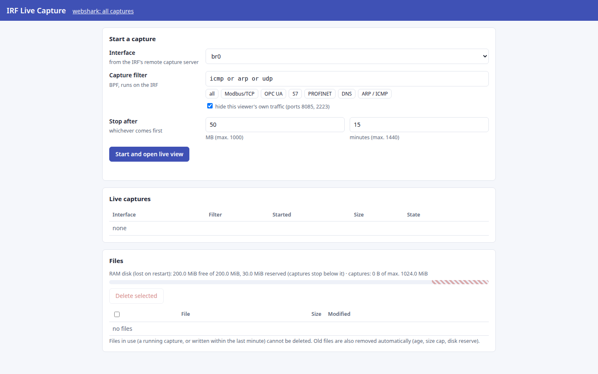
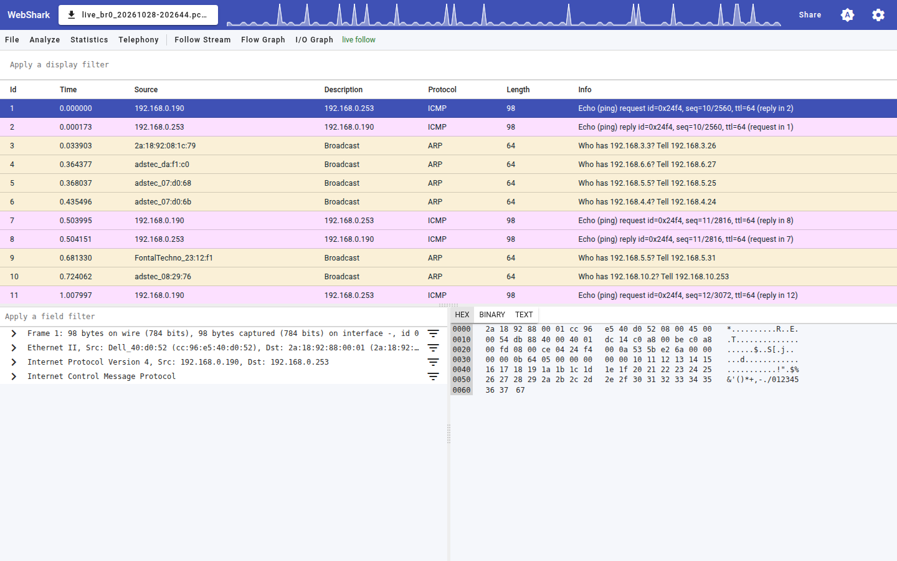
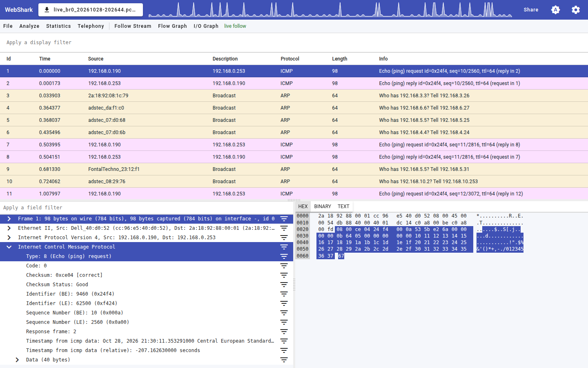
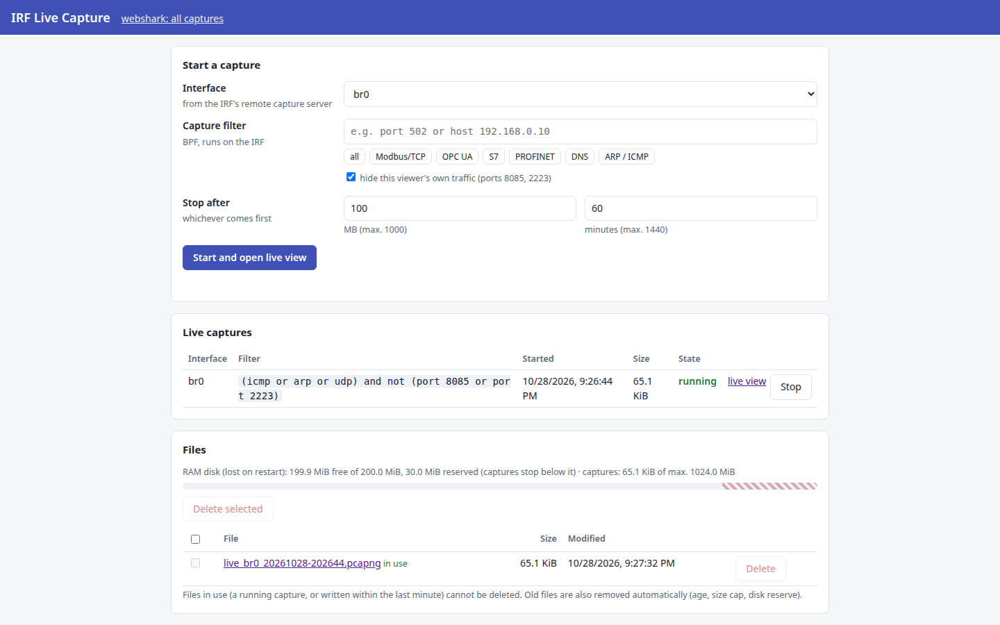
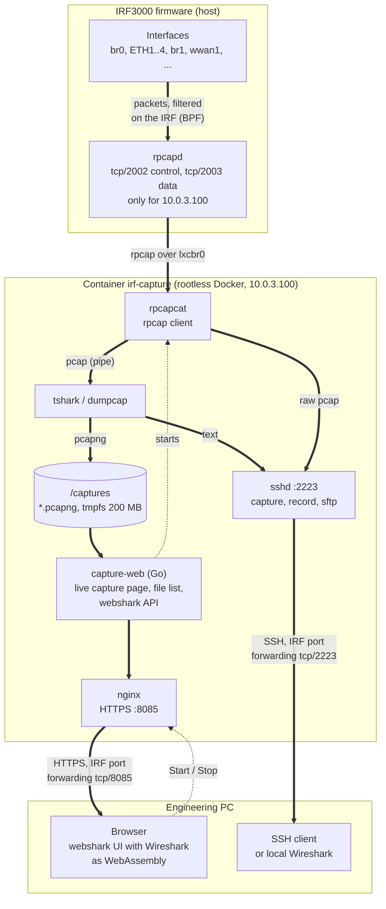
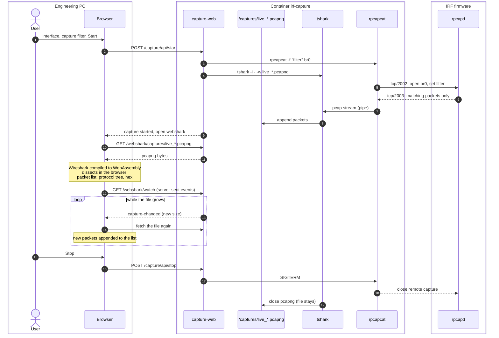

# Packet Capture for ADS-TEC IRF3000 (rpcap, tshark, webshark)

Sample container by **ADS-TEC Industrial IT**: packet capture in the rootless Docker of the IRF3000 industrial firewalls, using the IRF's built-in remote capture server (rpcapd). The IRF captures, the container connects to it over the Docker interface, so it needs no privileges.

- Live capture in the browser: choose an interface of the IRF and a capture filter, start, and watch the packets arrive in [webshark-ng](https://github.com/hepictel/webshark) (Wireshark as WebAssembly)
- tshark over SSH on port 2223 (user `cap`): live packet lists, full decode, display filters, background recordings
- Live into a local Wireshark: `ssh -p 2223 cap@<irf> rpcapcat -f "'not port 2223'" br0 | wireshark -k -i -`
- Capture filters run on the IRF, only matching packets reach the container
- Captures in RAM (tmpfs, 200 MB by default) or on a volume; file list with delete, size cap, retention period, and a guard that stops all captures before the filesystem runs full

```
IRF                                         Docker namespace (10.0.3.100)
br0/ETH1/... -> rpcapd :2002/:2003  <-----  rpcapcat -> tshark -> /captures/*.pcapng
                BPF filter runs here                       capture-web (:8085) -> browser
```

**The remote capture server gives access to all traffic of the IRF.** `setup_rpcap.py` makes it reachable from the Docker interface only and for the container's address only. Enable it only while it is needed (`setup_rpcap.py --disable`).

## Screenshots

| | |
|---|---|
| [](screenshots/01-capture-start.png) | [](screenshots/02-live-view.png) |
| **Start a capture:** interface of the IRF, capture filter (presets), limits; below the files and the RAM disk usage | **Live view:** webshark follows the growing capture (*live follow*) |
| [](screenshots/03-packet-detail.png) | [](screenshots/04-overview.png) |
| **Packet detail:** protocol tree and bytes, dissected in the browser (Wireshark as WebAssembly) | **Overview:** running capture with the effective filter, stop; files in use cannot be deleted |

## How it works

### Components: what runs where

The IRF captures, the container only receives. Thick arrows are packets, from the IRF's interfaces at the top to the screen at the bottom; dashed arrows are control. Everything the browser shows comes from pcapng files that the container writes and the browser dissects itself.



SSH host keys, the generated passwords and the TLS certificate are kept in a separate volume, `/state`.

### A live capture, step by step



### Where the displayed data comes from

| Shown in | Element | Source |
|---|---|---|
| live capture page | interface list | `rpcapcat -l`: the rpcapd lists the IRF's interfaces (`pcap_findalldevs_ex`) |
| live capture page | running captures, state, exit message | capture-web (processes it started, rpcapcat statistics) |
| live capture page | file list | directory listing of `/captures` |
| live capture page | disk bar, reserve | `statfs` of `/captures` (tmpfs or Docker partition), `CAPTURE_MIN_FREE` |
| webshark | packet list, protocol tree, hex, statistics, follow stream | the pcapng file, downloaded by the browser and dissected there by Wireshark (WASM); no dissection on the IRF or in the container |
| webshark | live follow | `/webshark/watch`: capture-web reports the growing file size, the browser fetches the file again |
| SSH (`capture`) | packet list as text | tshark in the container, reading the pcap stream from rpcapcat |
| local Wireshark | packets | `ssh ... rpcapcat ...`: the raw pcap stream over SSH, dissected on the PC |

In every case the packets themselves come from the IRF's interfaces via the rpcapd; the capture filter is applied on the IRF before anything crosses the Docker interface.

## Quick start

1. Enable the remote capture server on the IRF (see [Configure the IRF](#configure-the-irf)).
2. Get the image: `docker pull adstec/irf-capture` on the IRF (needs internet access), or pull it on a workstation and load it onto the IRF: `docker pull --platform linux/arm64 adstec/irf-capture && docker save adstec/irf-capture | DOCKER_HOST=tcp://192.168.0.254:2375 docker load`. To build it yourself see [Build](#build).
3. Start the container:

```bash
export DOCKER_HOST=tcp://192.168.0.254:2375
docker compose up -d          # or:
docker run -d --name capture --hostname capture --restart unless-stopped \
  --network host --tmpfs /captures:size=200m -v capture-state:/state \
  -e WEB_LISTEN=0.0.0.0:8085 -e TLS_SAN=IP:<irf-address> -e TZ=Europe/Berlin \
  adstec/irf-capture
docker logs capture           # generated passwords, TLS fingerprint, interfaces of the IRF
```

4. Open `https://<irf-address>:8085/` (user `cap`, password from the log; check the certificate fingerprint from the log, the certificate is self-signed), or log in with `ssh -p 2223 cap@<irf-address>`.

No `--privileged`, no additional capabilities.

## Usage

### Browser
- `/` (`/capture/`): interface, capture filter (with presets for Modbus/TCP, OPC UA, S7, PROFINET, ...), size and time limit; "Start and open live view" opens the capture in webshark with *live follow*. Below: running captures (stop) and all files (open, delete).
- `/webshark/`: webshark with all capture files.
- "hide this viewer's own traffic" (default on) excludes the SSH and web port; the live view itself runs over the LAN interface.

Without `WEB_LISTEN` the web UI listens on `127.0.0.1:8085` only and is reached through SSH: `ssh -N -L 8085:127.0.0.1:8085 -p 2223 cap@<irf-address>`, then `http://localhost:8085/`.

With `WEB_LISTEN=0.0.0.0:8085` it is reachable directly: nginx in the container terminates HTTPS on that port (`http://` is redirected) and the UI is protected by HTTP basic auth. The certificate is self-signed and generated once in `/state/tls` (SAN from `TLS_CN` and `TLS_SAN`, fingerprint in `docker logs`); to use your own, put `server.crt` and `server.key` there and restart the container. Over HTTPS (or the SSH tunnel) the page is a secure, cross-origin isolated context, so RTP audio playback in webshark works too. `WEB_TLS=no` serves plain HTTP instead.

### SSH
```bash
ssh -p 2223 cap@<irf-address>
rpcapcat -l                                # interfaces of the IRF
capture br0 'port 502'                     # live packet list (capture filter)
capture br0 'port 502' -- -V               # full decode, any tshark options
capture eth1 -- -Y 'modbus.func_code == 6' # display filter
record start br0 'not port 2223'           # background recording to /captures
record list
record stop all
sftp -P 2223 cap@<irf-address>             # download from /captures
```

## Environment

| Variable | Default | Meaning |
|---|---|---|
| `RPCAP_HOST` | default gateway | Address of the IRF's rpcapd (Docker interface) |
| `RPCAP_PORT` | `2002` | rpcapd control port |
| `CAPTURE_MAX_SIZE` | `1G` | Total size cap of the captures |
| `CAPTURE_MIN_FREE` | `15%` | Kept free on the filesystem of `/captures` (% or size); all captures stop below it |
| `CAPTURE_RETENTION_DAYS` | `14` | Captures older than this are deleted |
| `RECORD_FILE_SIZE` | `50M` | SSH recordings rotate at this size |
| `RECORD_IFACE` / `RECORD_FILTER` | empty | Recording started with the container |
| `SSH_PORT` | `2223` | SSH port |
| `SSH_PASSWORD` | random, printed once, kept in `/state` | Password of user `cap` |
| `SSH_AUTHORIZED_KEYS` | empty | Public key(s); with a key and no password, password login is disabled |
| `WEB` | `yes` | Web UI |
| `WEB_LISTEN` | `127.0.0.1:8085` | `0.0.0.0:8085`: reachable directly, HTTP basic auth (user `cap`) |
| `WEB_PASSWORD` | SSH password, else random (kept in `/state`) | Basic auth password |
| `WEB_TLS` | `yes` | HTTPS through nginx when `WEB_LISTEN` is reachable from outside |
| `TLS_CN` / `TLS_SAN` | `irf-capture` / empty | Self-signed certificate, e.g. `TLS_SAN=IP:192.168.0.254,DNS:irf.example` |
| `TZ` | `UTC` | Time zone for file names |

Volumes: `/captures` (tmpfs or volume) and `/state` (SSH host keys, generated passwords, TLS certificate; keep it persistent).

## Storage and disk space

`/captures` is a 200 MB tmpfs in `docker-compose.yml`: a hard size limit, no flash wear, and nothing can fill the IRF's Docker partition. The captures are lost when the container or the IRF restarts. For persistent captures mount a volume on `/captures` instead; it then shares the Docker partition with the images and all containers.

In both cases `CAPTURE_MIN_FREE` stays free: a live capture only starts if its size limit fits above the reserve, the web server checks every 2 s and stops every capture (live captures and SSH recordings) below it, and the oldest finished captures are then deleted until the reserve is free again.

## Configure the IRF

`setup_rpcap.py` applies the IRF settings for this sample through the JSON-RPC API and saves them. It needs `jsonrpcdevice.py` from [ads-tec/Python-AdstecJSONRPCDevice](https://github.com/ads-tec/Python-AdstecJSONRPCDevice) (next to the script or on `PYTHONPATH`) and `pip install requests`:

```bash
python3 setup_rpcap.py --device 192.168.0.254 --web
python3 setup_rpcap.py --device 192.168.0.254 --disable
python3 setup_rpcap.py --help
```

The script:
- enables Docker and pins the Docker DHCP pool to `10.0.3.100`
- enables the remote capture server for the client `10.0.3.100` only (`rpcap_hostlist`) and denies it on every interface except the Docker interface (`rpcap_access`)
- firmware 3.0 (INPUT default-deny): checks that the INPUT allow table opens tcp/2002 and tcp/2003 on the Docker interface only
- forwards tcp/2223 (SSH) and with `--web` tcp/8085 from the interface that holds `--device` to the container
- `--disable`: remote capture off, the allow rows and the forwarding rules removed

The password is asked for if `--password` is omitted.

## Build

Build on a workstation for the IRF architecture and load the image onto the IRF through its Docker socket (the IRF itself does not need internet access):

```bash
docker buildx build --platform linux/arm64 -t adstec/irf-capture --load .
docker save --platform linux/arm64 adstec/irf-capture | DOCKER_HOST=tcp://192.168.0.254:2375 docker load
```

Use `--platform linux/arm/v7` for ARMv7 devices. Behind an HTTP proxy, pass `--build-arg HTTP_PROXY=... --build-arg HTTPS_PROXY=...`; behind a TLS-inspecting proxy also its CA with `--secret id=build_ca,src=proxy-ca.pem`. Neither is stored in the image.

The build compiles libpcap with remote capture support (Alpine's has none; source checksum pinned) and `rpcapcat`, builds the webshark-ng UI from a pinned commit, and builds `capture-web`, a small Go server that serves the UI, the capture files and the live capture page in place of webshark's Node.js API. Image size about 185 MB, most of it libwireshark.

## Files

| File | |
|---|---|
| `Dockerfile`, `docker-compose.yml`, `entrypoint.sh`, `motd` | image and container |
| `src/rpcapcat.c` | remote capture client: interface list, capture with the filter on the IRF, pcap to stdout |
| `web/` | `capture-web`: webshark API, live capture page and API, file list, disk space guard (behind nginx for HTTPS) |
| `bin/capture`, `bin/record`, `bin/capture-retention` | SSH tools and retention |
| `setup_rpcap.py` | IRF configuration |

## Links

- [`adstec/irf-capture`](https://hub.docker.com/r/adstec/irf-capture) - prebuilt image on Docker Hub
- [webshark-ng](https://github.com/hepictel/webshark) - web UI, used unmodified
- [IRF3000 industrial firewall](https://www.ads-tec-iit.com/en/reliable-remote-access/firewall-router/irf3000/) - product page of ADS-TEC Industrial IT

## Platforms and license

`linux/arm64` (IRF3000), `linux/arm/v7`. The sample code is BSD-2-Clause. The image contains Wireshark/tshark (GPLv2), libpcap (BSD) and the webshark-ng UI (AGPL-3.0, unmodified; license and source link in the image at `/usr/share/webshark/`).
